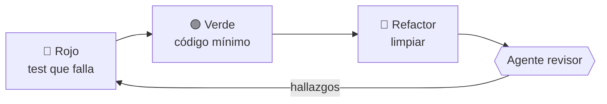

# 📚 TareasYA

**Organizador de tareas y estudio para estudiantes.** Centraliza tareas, trabajos prácticos y fechas de entrega por materia, prioridad y fecha límite, y avisa antes de que venzan.

🌐 **Probala online: [tareasya-og.onrender.com](https://tareasya-og.onrender.com/)**
<sub>(Está en el plan gratuito de Render: si estuvo un rato sin uso, la primera carga puede tardar hasta un minuto.)</sub>


| Vista lista (tema claro) | Vista tablero (tema oscuro) |
|---|---|
|  |  |

---

## 🎯 ¿Qué problema resuelve?

Los estudiantes organizan sus entregas en cuadernos, mensajes sueltos o el chat del curso, y las fechas se pierden. TareasYA junta todo en un solo lugar, ordenado por lo que vence primero.

## ✨ Funcionalidades

**Gestión de tareas**
- ✅ Crear, editar y eliminar tareas (con confirmación al eliminar)
- ☑️ Completar una tarea con un solo clic desde el círculo de cada tarjeta
- 🏷️ Estados (pendiente, en curso, completada), prioridad, materia y favoritas
- 🚫 Regla anti-duplicados: no permite dos tareas activas con el mismo título y materia

**Organización y seguimiento**
- 🔎 Búsqueda por título o materia, filtros y orden (fecha, prioridad, recientes)
- 📊 Resumen con contadores y **barra de progreso** del porcentaje completado
- ⏰ Destaque de tareas vencidas y aviso de las que vencen en 48 h
- 🔔 Notificaciones del navegador (con tu permiso)
- ▦ **Vista Tablero** (pendientes / en curso / completadas) o vista Lista; recuerda tu elección

**Experiencia**
- 🎨 Diseño renovado: cabecera con degradado, saludo según la hora, tarjetas con animaciones
- 🌗 **Selector de tema** (automático, claro u oscuro), guardado en tu navegador
- ⬇️ **Exportar** todas tus tareas a un archivo JSON
- 📱 Diseño responsive y respeto por la preferencia de "reducir animaciones"
- 📴 **Modo local:** si no hay servidor, la app funciona igual guardando en el navegador

**API**
- 🔌 Endpoints de resumen y de tareas próximas a vencer

## 🧱 Tecnologías

| Parte | Stack |
|-------|-------|
| Frontend | React 18, Vite 5, CSS propio (variables, modo oscuro) |
| Backend | Node.js, Express 5 (arquitectura en capas) |
| Persistencia | Archivo JSON con escritura atómica (o `localStorage` en modo local) |
| Pruebas | Vitest (frontend) y `node:test` (backend) |
| Hosting | Render (un solo servicio: Express sirve la API y la interfaz) |

## 📁 Estructura

```
TareasYA/
├── package.json    scripts de build y start para producción
├── CLAUDE.md       contexto para agentes de IA
├── .claude/agents/ revisor.md, tdd.md
├── backend/
│   ├── src/        app.js, server.js, routes/, controllers/, services/, repositories/, logic/
│   ├── test/       tests de la API y de la lógica
│   ├── openapi.yaml, requests.http
│   └── data/       tareas.json (se crea solo, ignorado por git)
├── frontend/
│   ├── index.html
│   └── src/        App.jsx, components/, logic/ (+ tests), styles.css
└── docs/           SPEC, bitácora, capturas y entregas de los TP
```

## 🚀 Instalación y uso

**Requisito:** [Node.js](https://nodejs.org) 18 o superior.

```bash
git clone https://github.com/TU_USUARIO/TareasYA.git
cd TareasYA
```

### Opción A: modo producción (un solo proceso)

Es la misma forma en que corre online. Compila el frontend y el servidor lo sirve junto con la API.

```bash
npm run build
npm start
```

Abrí http://localhost:3001.

### Opción B: modo desarrollo (con recarga en vivo)

Hacen falta **dos terminales** abiertas a la vez.

**Terminal 1: backend** (http://localhost:3001)

```bash
cd backend
npm install
npm start
```

**Terminal 2: frontend** (http://localhost:5173)

```bash
cd frontend
npm install
npm run dev
```

Abrí http://localhost:5173. Si no ves el aviso amarillo de "Modo local", la app está conectada al backend.

> 💡 **Windows / PowerShell:** si aparece el error *"la ejecución de scripts está deshabilitada"*, usá `npm.cmd` en lugar de `npm` (por ejemplo `npm.cmd install`), o abrí el Símbolo del sistema (cmd).

## ☁️ Publicación online (Render)

La app se publica como **un único Web Service**: el servidor Express sirve la API en `/api` y, si existe `frontend/dist`, también la interfaz compilada.

1. Subí el repositorio a GitHub (con `package.json` en la raíz).
2. En [render.com](https://render.com): **New → Web Service** y conectá el repositorio.
3. Configuración:

| Campo | Valor |
|-------|-------|
| Language | Node |
| Branch | `main` |
| Root Directory | *(vacío)* |
| Build Command | `npm run build` |
| Start Command | `npm start` |
| Plan | Free |

4. **Deploy web service**. Cada vez que hagas un commit en `main`, Render vuelve a desplegar (o usá **Manual Deploy → Deploy latest commit**).

**Verificación:** `https://TU-SERVICIO.onrender.com/api/salud` debe responder `{"ok":true}`.

> ⚠️ **Sobre los datos en el plan gratuito:** el disco de Render es efímero, así que el archivo `tareas.json` se reinicia con cada redeploy o reinicio. Para que persistan hace falta un Disk (de pago) con la variable `TAREASYA_DB` apuntando a él, o migrar a una base de datos.

## 🧪 Pruebas

```bash
cd backend  && npm test    # 31 tests
cd frontend && npm test    # 22 tests
cd frontend && npm run build
```

## 🔌 API

Base: `/api`. Los errores responden `{ "error": "mensaje" }`.

| Método | Ruta | Descripción | Respuestas |
|--------|------|-------------|------------|
| GET | `/salud` | Disponibilidad | 200 |
| GET | `/tareas` | Lista. Query: `q`, `materia`, `estado`, `prioridad`, `favorito=true`, `orden=fecha\|prioridad\|creacion` | 200 |
| POST | `/tareas` | Crea una tarea | 201, 400, 409 |
| GET | `/tareas/resumen` | Contadores: total, por estado, vencidas y por vencer | 200 |
| GET | `/tareas/proximas` | Activas que vencen pronto. Query: `horas` (1 a 720, por defecto 48) | 200, 400 |
| GET | `/tareas/:id` | Obtiene una tarea | 200, 404 |
| PATCH | `/tareas/:id` | Edita campos | 200, 400, 404, 409 |
| DELETE | `/tareas/:id` | Elimina una tarea | 204, 404 |

Ejemplo:

```bash
curl -X POST https://tareasya-og.onrender.com/api/tareas \
  -H "Content-Type: application/json" \
  -d '{"titulo":"TP de Física","materia":"Física","fechaLimite":"2026-12-01T20:00","prioridad":"alta"}'
```

Referencia completa: [`docs/API.md`](docs/API.md) · OpenAPI: [`backend/openapi.yaml`](backend/openapi.yaml) · Peticiones de prueba para VS Code: [`backend/requests.http`](backend/requests.http).

### Modelo de una tarea

```json
{
  "id": "mhk3x9...",
  "titulo": "TP de Física",
  "descripcion": "",
  "materia": "Física",
  "fechaLimite": "2026-12-01T23:00:00.000Z",
  "prioridad": "alta",
  "estado": "pendiente",
  "favorito": false,
  "fechaCreacion": "2026-11-03T18:00:00.000Z",
  "fechaActualizacion": "2026-11-03T18:00:00.000Z"
}
```

## 🔁 Desarrollo con TDD y agentes de IA

El backend se desarrolla con el ciclo **Rojo → Verde → Refactor**: primero un test que falla (por la razón correcta), después el código mínimo y al final la limpieza, con un commit por fase.



Dos agentes de IA acompañan el flujo (carpeta `.claude/agents/`):

| Agente | Qué hace | Permisos |
|--------|----------|----------|
| `tdd` | Guía el ciclo y hace un commit por fase | Lee y escribe |
| `revisor` | Revisa seguridad y robustez del diff con cinco preguntas fijas | Solo lectura |

El archivo [`CLAUDE.md`](CLAUDE.md) le da a los agentes el contexto del proyecto. Más detalle: [flujo de trabajo](docs/FLUJO-DE-TRABAJO.md) y [registro de los dos ciclos con salidas reales de tests](docs/TDD-ROJO-VERDE-REFACTOR.md).

## 🏗️ Arquitectura

Backend en capas, cada una con una sola responsabilidad:

```
Ruta → Controller → Service → Lógica (reglas puras)
                         └──→ Repositorio → data/tareas.json
```

En producción, el mismo servidor Express entrega la API (`/api`) y los archivos estáticos del frontend (`frontend/dist`), por lo que no hace falta configurar CORS ni dos hosts.

El frontend accede a los datos solo a través de `taskClient.js`, que usa la API si el servidor responde y `localStorage` si no. Más detalle en [`docs/SPEC-TareasYA.pdf`](docs/SPEC-TareasYA.pdf).

## 📖 Documentación

- [SPEC y plan técnico](docs/SPEC-TareasYA.pdf)
- [Referencia de la API](docs/API.md)
- [Flujo de trabajo con agentes](docs/FLUJO-DE-TRABAJO.md)
- [Ciclo Rojo-Verde-Refactor](docs/TDD-ROJO-VERDE-REFACTOR.md)
- [Revisiones de código](docs/revisiones/)
- [Bitácora de versiones](docs/BITACORA-TareasYA.pdf) ([versión Markdown](docs/BITACORA.md))
- `docs/entregas/`: entregas de cada trabajo práctico

## ⚠️ Limitaciones conocidas

- Sin autenticación: todas las personas que entran ven y editan las mismas tareas. Pensado para uso personal.
- Persistencia en JSON: adecuada para pocas tareas; en el plan gratuito de Render los datos no sobreviven a un reinicio.
- El servicio gratuito se "duerme" tras un rato de inactividad y la primera carga es lenta.
- La interfaz tiene tests de lógica, pero no tests de componentes ni de punta a punta.

## 🗺️ Próximos pasos

- [x] Publicar la app online
- [x] Rediseño de la interfaz, vista tablero, tema claro/oscuro y exportación
- [ ] Que el frontend use `/resumen` y `/proximas`
- [ ] Persistencia real (Disk de Render o base de datos) y migración a SQLite con paginación
- [ ] Cuentas de usuario
- [ ] Subtareas, etiquetas de colores y vista de calendario
- [ ] Tests de componentes y pruebas en celular
- [ ] PWA y recordatorios configurables

## 👤 Autor

**Santino Crespo** · 6.° 2.ª · E.T. N.° 35 "Ing. Eduardo Latzina"

Proyecto educativo.
