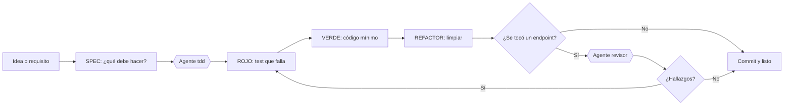

# Flujo de trabajo con agentes de IA

Cómo se construye una funcionalidad en TareasYA combinando tests, agentes y revisión.

## Visión general



Si el revisor encuentra algo, el hallazgo vuelve al principio del ciclo: **primero un test que lo muestre (rojo)**, después el arreglo.

## Los dos agentes

| Agente | Archivo | Qué hace | Puede escribir archivos |
|--------|---------|----------|-------------------------|
| `tdd` | `.claude/agents/tdd.md` | Lleva el ciclo Rojo-Verde-Refactor y hace un commit por fase | Sí |
| `revisor` | `.claude/agents/revisor.md` | Revisa seguridad y robustez con cinco preguntas fijas | No (`readonly: true`) |

El revisor es el que se afinó en el TP 6 (cinco cambios) y se midió en el TP 7. Se mantiene sin permiso de escritura a propósito: un revisor que también corrige deja de ser un control independiente.

## Paso a paso para una funcionalidad nueva

1. **Definir el comportamiento** en una o dos frases y sus casos límite (qué pasa con vacío, con datos inválidos, con el borde exacto).
2. **Rojo.** Pedirle al agente `tdd` que escriba solo los tests. Verificar que fallan por la razón correcta.
   ```bash
   cd backend && npm test      # tiene que mostrar "fail" > 0
   ```
3. **Verde.** Implementar lo mínimo. Correr **toda** la suite.
4. **Refactor.** Limpiar sin tocar los tests. Correr la suite tras cada cambio.
5. **Revisión.** Si hubo endpoints nuevos o modificados, invocar al revisor sobre el diff:
   > Usá el agente revisor para revisar el git diff de este ciclo.
6. **Documentar.** Actualizar `docs/API.md` y `backend/openapi.yaml` si cambió el contrato.
7. **Commit** por fase con los prefijos `test(rojo):`, `feat(verde):`, `refactor:`.

## Reglas que hacen que el flujo funcione

- **Un test en rojo que pasa de entrada está mal**: no prueba nada nuevo.
- **No se escribe código sin un test que lo pida.**
- **El refactor no toca tests.** Si hace falta tocarlos, es un cambio de comportamiento y arranca otro ciclo.
- **Los agentes proponen, la persona decide.** Cada fase termina con una verificación que se puede repetir (la suite de tests), no con "parece que anda".
- **Las revisiones son por diff**, no sobre todo el repositorio.

## Ejemplo real

Los ciclos 1 y 2 de [`TDD-ROJO-VERDE-REFACTOR.md`](TDD-ROJO-VERDE-REFACTOR.md) siguieron este flujo, con sus salidas reales de tests y el historial de commits. La revisión de ese diff está en [`revisiones/2026-11-03-endpoints-resumen-proximas.md`](revisiones/2026-11-03-endpoints-resumen-proximas.md).

## Uso en Claude Code

Los archivos de `.claude/agents/` son subagentes de proyecto: Claude Code los detecta al abrir la carpeta. Se pueden invocar por nombre ("usá el agente tdd para agregar...") o los activa solo el texto de su `description`. El archivo `CLAUDE.md` de la raíz le da al agente principal el contexto del proyecto (comandos, arquitectura y reglas).
